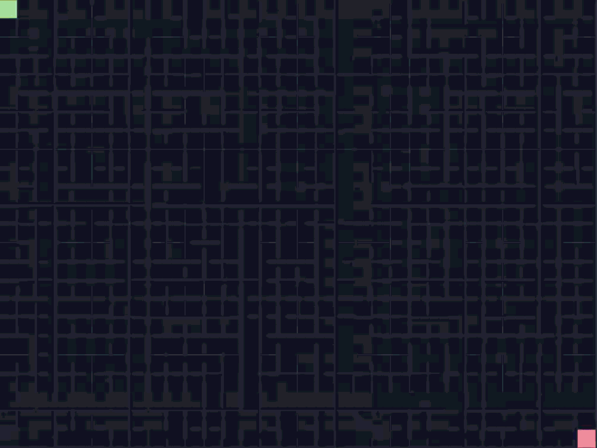
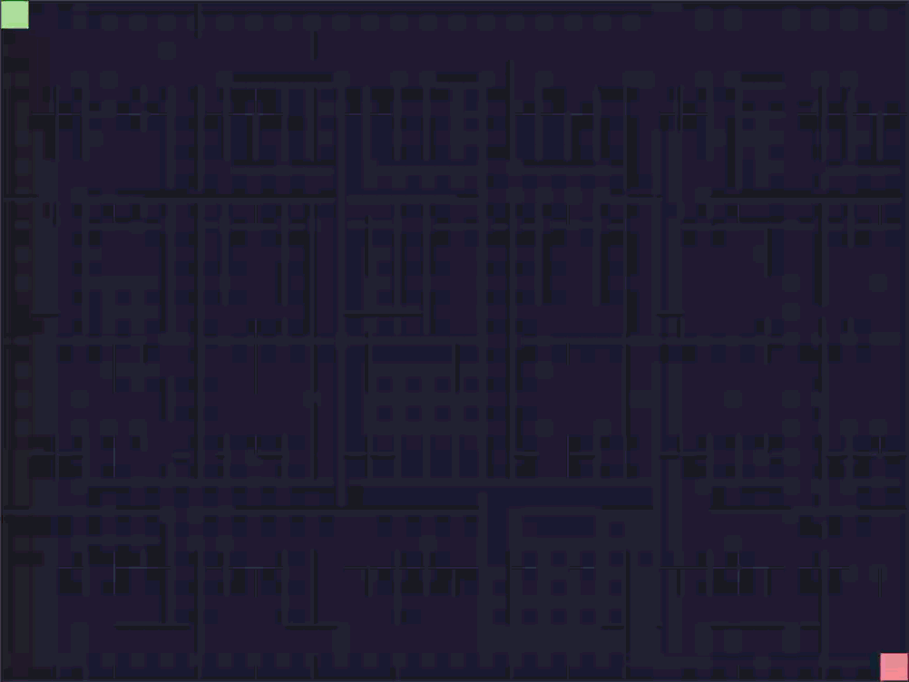
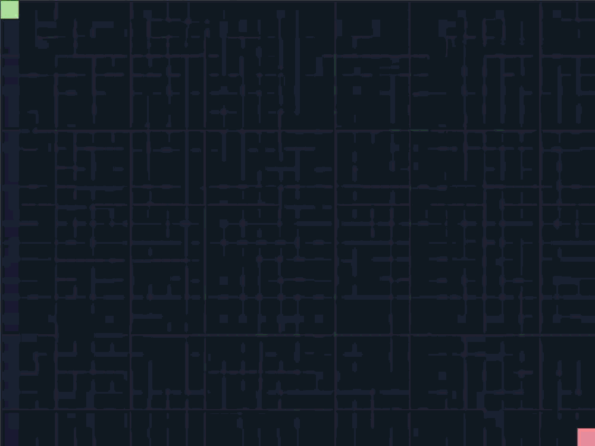
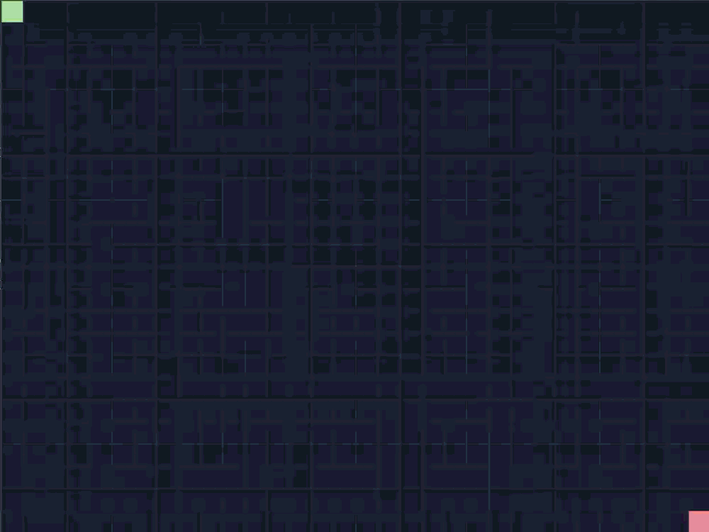
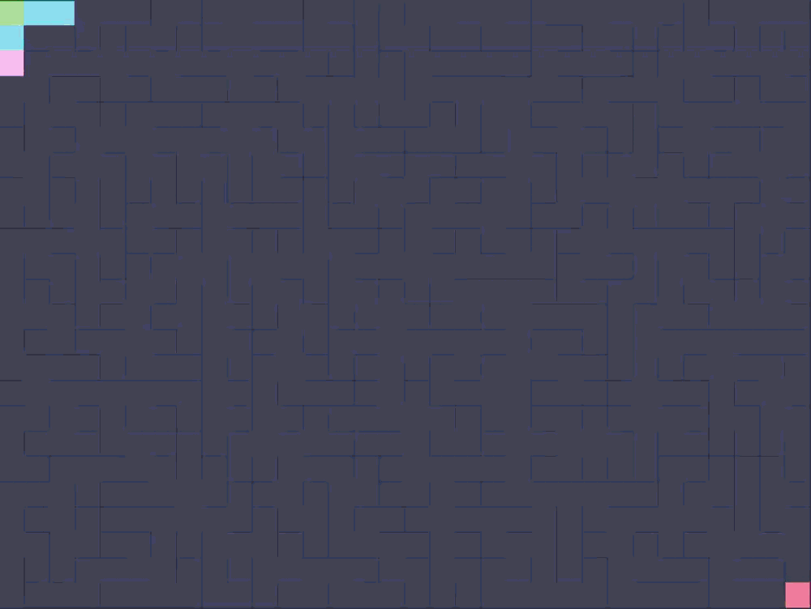
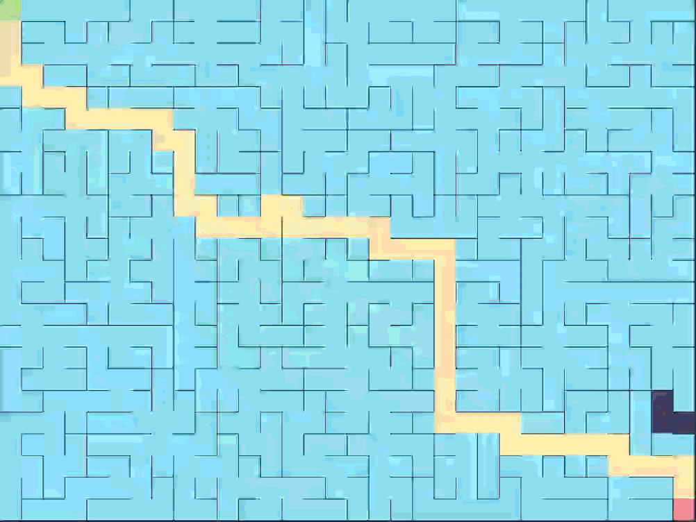
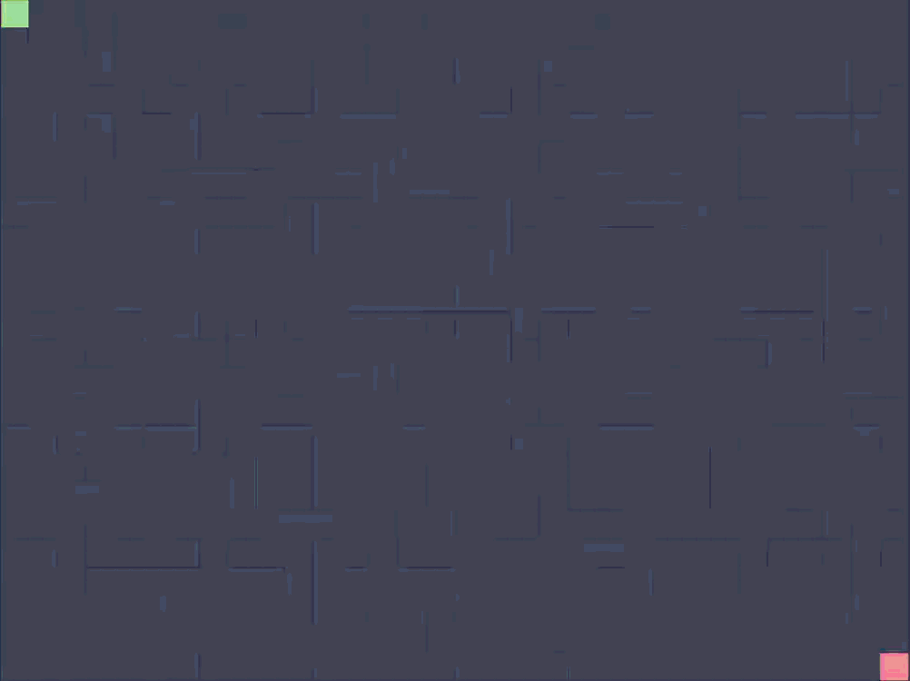
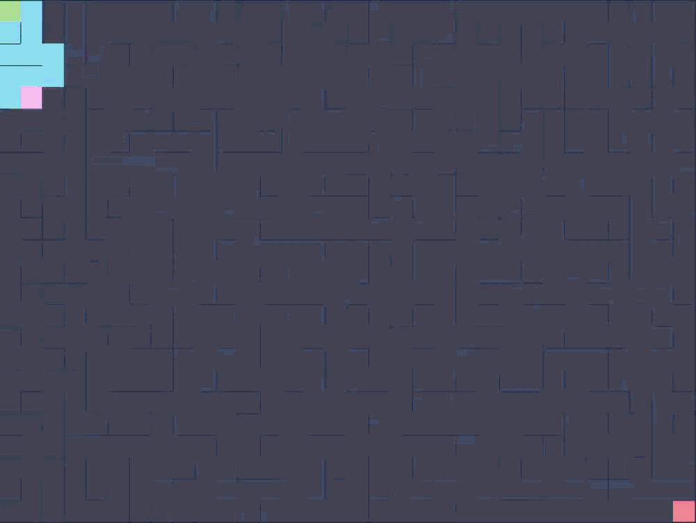
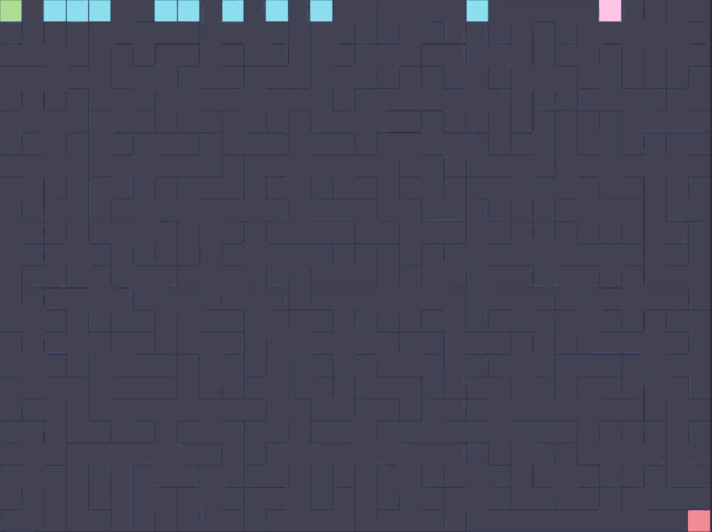

# 🧠 Algorithms: How Pathfinder Thinks

This project visualizes how computers "think" when navigating space. Below is a breakdown of the algorithms used to generate and solve the mazes.

## 📑 Table of Contents
1. [🏗️ Maze Generation](#️-maze-generation)
   * [Recursive Backtracker (DFS)](#1-recursive-backtracker-dfs)
   * [Prim's Algorithm](#2-prims-algorithm)
   * [Kruskal's Algorithm](#3-kruskals-algorithm)
   * [Wilson's Algorithm](#4-wilsons-algorithm)
2. [🧩 Maze Solving](#-maze-solving)
   * [Breadth-First Search (BFS)](#1-breadth-first-search-bfs)
   * [Depth-First Search (DFS)](#2-depth-first-search-dfs)
   * [A* (A-Star) Search](#3-a-a-star-search)
   * [Wall Follower](#4-wall-follower)
   * [Dead-End Filling](#5.dead-end-filling)
3. [📚 Definitions](#-definitions)

---

## 🏗️ Maze Generation

These algorithms start with a grid full of walls and carve out paths to create a "perfect maze" (where every point is reachable, but there are no loops).

### 1. Recursive Backtracker (DFS)
**Type:** Depth-First Search (DFS)  
**Style:** Long, winding corridors with a directional bias.

**How it works:**
1. **Choose a starting cell** and mark it as visited.
2. **Look around** for unvisited neighbors (Top, Right, Bottom, Left).
3. **If a neighbor is found:**
    * Knock down the wall between the current cell and the neighbor.
    * Move to that neighbor.
    * Add the current spot to a "Stack" (a breadcrumb trail).
4. **If NO neighbor is found (Dead End):**
    * Backtrack! Pop the last cell off the stack and go back there.
    * Repeat until you find a cell with unvisited neighbors.

> **⚡ Performance:** Fast and memory-efficient.

  

### 2. Prim's Algorithm
**Type:** Spanning Tree Growth  
**Style:** Bushy mazes with many dead-ends and a centered bias.

**How it works:**
* Start with a random cell already in the "maze."
* Look at all **walls** adjacent to cells already in the maze.
* Pick a random wall from this list.
* If the wall connects to an unvisited cell, knock it down and add that cell to the maze.
* Repeat until all cells are part of the maze.

> **🌳 The Analogy:** Imagine a forest growing outward from a seed. Trees expand in all directions, creating a dense, bushy pattern.
> 
> **⚡ Performance:** Balanced and produces highly aesthetic, complex mazes.

  

### 3. Kruskal's Algorithm
**Type:** Disjoint Set Union (Union-Find)  
**Style:** Perfectly uniform, unbiased mazes.

**How it works:**
* Start with every cell in its own isolated group.
* List all walls in the maze and shuffle them randomly.
* For each wall:
    * Check if it connects two cells from **different groups**.
    * If yes, knock down the wall and **merge** the two groups.
    * If no, skip it.
* Continue until all cells are connected into a single group.

> **🏝️ The Analogy:** Imagine separate islands merging together by removing the water between them. Eventually, all islands become one single continent.
> 
> **⚡ Performance:** Creates statistically random, highly unbiased mazes.

  

### 4. Wilson's Algorithm
**Type:** Loop-Erased Random Walk  
**Style:** Perfectly uniform spanning tree (the gold standard).

**How it works:**
* Start with one random cell in the maze.
* Pick an unvisited cell and start a random walk from it.
* Walk randomly until you either:
    * **Hit a cell already in the maze** → Erase the loop you created and add the entire path to the maze.
    * **Return to your starting cell** → Erase the loop and try again.
* Repeat until all cells are in the maze.

> **🚶 The Analogy:** Like a person walking around aimlessly until they find their way home. Once they find home, we map their path, but erase any circles they walked in.
> 
> **⚡ Performance:** Slower to start, but mathematically proven to produce the most statistically uniform mazes possible.

  

---

## 🧩 Maze Solving

Once the maze is built, these algorithms search for the shortest path from the **Start Node** to the **End Node**.

### 1. Breadth-First Search (BFS)
**Type:** Unweighted Search  
**Guarantee:** Always finds the Shortest Path.

**How it works:**
* Imagine pouring water into the maze at the Start.
* The water flows into every open hallway equally, expanding in all directions at the exact same speed.
* The moment the water touches the End Node, we trace the flow back to the start.

  

### 2. Depth-First Search (DFS)
**Type:** Unweighted Search  
**Guarantee:** Does NOT guarantee the shortest path.

**How it works:**
* DFS is like a person walking in a maze who refuses to stop until they hit a wall.
* It picks a path and aggressively follows it until it hits a dead end.
* It then backtracks and tries the next available turn.

> **Pros/Cons:** It can be incredibly fast if it gets lucky and chooses the right direction, but it often finds a winding, highly inefficient path.

  

### 3. A* (A-Star) Search
**Type:** Weighted Search + Heuristic  
**Guarantee:** Always finds the Shortest Path (and usually faster than BFS).

**How it works:**
* A* is "smart." It doesn't just flood everywhere blindly like BFS.
* It uses a **Heuristic** (a mathematical guess) to estimate which cells are physically closer to the End Node.
* It prioritizes checking cells that move *towards* the goal, acting like a guided missile rather than a flood.

**The Math:** `f(n) = g(n) + h(n)`
* `g(n)` = Actual distance from Start.
* `h(n)` = Estimated distance to End (Manhattan Distance).

> **⚡ Performance:** Highly efficient; skips checking many unnecessary cells.

  

### 4. Wall Follower
**Type:** Deterministic Following  
**Guarantee:** Finds the exit (but rarely the shortest path).

**How it works:**
* Imagine putting your **right hand on the right wall** of the maze.
* Walk forward while keeping your hand on the wall at all times.
* Your hand will follow the wall's contours, naturally guiding you out of dead ends.

> **✋ The Analogy:** This is the classic "hand on the wall" trick used by humans to escape physical corn mazes by touch alone.
> 
> **⚠️ Limitation:** Only works on **simply-connected mazes** (mazes without isolated islands/loops). 

  

### 5. Dead-End Filling
**Type:** Elimination Method  
**Guarantee:** Always finds the Shortest Path.

**How it works:**
* Scan the entire maze to identify all **dead-ends** (cells surrounded by 3 walls).
* "Fill in" (mark as invalid) each dead-end cell.
* As you fill them in, new dead-ends are created. Continue moving inward.
* Stop when no dead-ends remain. The unfilled paths are the solution.

> **✂️ The Analogy:** Like trimming dead branches from a tree. You keep cutting off the twigs until only the main trunk remains.
> 
> **⚡ Performance:** Highly elegant; processes the maze visually from the outside in.

  

---

## 📚 Definitions

* **Node/Cell:** A single square in the grid.
* **Edge:** The connection between two cells (an open hallway).
* **Heuristic:** A mathematical estimate or "best guess" used to speed up an algorithm (used in A*).
* **Stack:** A "Last-In, First-Out" data structure (like a stack of plates). Used heavily in DFS and Backtracking.
* **Queue:** A "First-In, First-Out" data structure (like a line at a grocery store). Used heavily in BFS.
