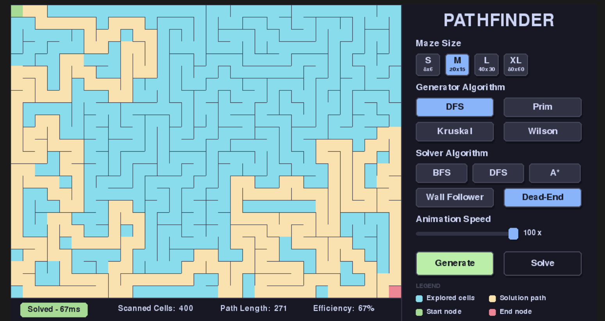

# 🧩 Pathfinder

> An interactive visualization tool that shows how computers **generate and solve mazes** using different algorithms. Watch algorithms come to life as they carve paths through mazes and find their way to the exit in real-time.


---

## 📸 Screenshot



---

## 🌐 Live Demo

Try it directly in your browser — no installation needed:

**[→ Launch Pathfinder](https://mchithna.github.io/PathFinder/)**

> **Note:** This is the WebAssembly port via Pygbag. For smoother performance and full rendering speed, run it locally (see [Getting Started](#-getting-started)).

---

## ✨ Features

- **4 Maze Generators** — DFS, Prim's, Kruskal's, and Wilson's, each producing a visually distinct maze character
- **5 Pathfinding Solvers** — BFS, DFS, A\*, Wall Follower, and Dead-End Filling
- **Animated visualization** — watch the frontier expand cell by cell in real time
- **Adjustable speed** — from 0.01× slow-motion study to 100× fast-forward
- **Live stats bar** — tracks scanned cells, path length, and solver efficiency after every run
- **4 maze sizes** — S (8×6) through XL (80×60) to stress-test any algorithm
- **Web + Desktop** — runs natively with Pygame or in any modern browser via Pygbag

---

## 🚀 Getting Started

### Prerequisites

- Python 3.10 or higher
- pip

### Clone & Run

```bash
# 1. Clone the repository
git clone https://github.com/mchithna/PathFinder.git
cd pathfinder

# 2. Install dependencies
pip install pygame

# 3. Run
python main.py
```

That's it. No virtual environment required for a basic run.


---

## 🎮 How to Use

| Step | Action |
|------|--------|
| 1 | Choose a **Maze Size** — start with M to get a feel for the algorithms |
| 2 | Pick a **Generator Algorithm** |
| 3 | Press **Generate** — watch the maze carve itself out |
| 4 | Pick a **Solver Algorithm** |
| 5 | Press **Solve** — the solver explores (cyan) then traces the path (yellow) |
| 6 | Read the **stats bar** at the bottom for scanned cells, path length, and efficiency |

### Color Legend

| Color | Meaning |
|-------|---------|
| 🟦 Cyan | Explored / visited cells |
| 🟨 Yellow | Final solution path |
| 🟩 Green | Start node |
| 🟥 Red | End node |

**Tip:** Run the same maze with BFS then A\* to see how the heuristic dramatically reduces the number of explored cells.

---

## 🧠 How It Works

Pathfinder is split into two phases: **generation** (building the maze) and **solving** (finding a path through it).

### 👾Maze Generation Algorithms

**DFS (Recursive Backtracker)**
- Carves one deep path, then backtracks to branch
- Result: Mazes with long winding corridors
- Style: Directional bias, corridor-heavy

**Prim's Algorithm**
- Grows a spanning tree from a random seed
- Result: Bushy mazes with many dead-ends
- Style: Balanced, centred bias

**Kruskal's Algorithm**
- Randomly merges cell groups by removing walls
- Result: Perfectly uniform (unbiased) mazes
- Style: No directional bias, statistically random

**Wilson's Algorithm**
- Uses loop-erased random walks
- Result: Perfectly uniform spanning tree (gold standard)
- Style: Truly unbiased but slower to start

### 🧩Maze Solving Algorithms

**BFS (Breadth-First Search)**
- Explores level-by-level using a queue
- Guarantee: Always finds shortest path
- Complexity: O(V + E)

**DFS (Depth-First Search)**
- Dives deep before backtracking using a stack
- Guarantee: Finds *a* path (not always shortest)
- Complexity: O(V + E)

**A\* (A-Star)**
- Combines BFS with Manhattan distance heuristic
- Guarantee: Finds shortest path while skipping irrelevant cells
- Complexity: More efficient than BFS on large mazes

**Wall Follower**
- Keeps virtual hand on right wall, follows it to exit
- Simple and intuitive to visualize
- Limitation: Only works on simply-connected mazes

**Dead-End Filling**
- Progressively seals all dead-ends from outside
- Result: Remaining path is the solution
- Style: Elimination method (not a search)

---                           

## 📁 Project Structure

```
PathFinder/
├── main.py              # Game loop & Pygame rendering
├── grid.py              # Maze grid data structure
├── generators.py        # 4 maze generation algorithms
├── solvers.py          # 5 maze solving algorithms
├── ui.py               # UI components (buttons, panels)
├── settings.py         # Configuration & constants
├── template/
│   └── index.html      # HTML template for pygbag web build
├── build/
│   └── web/            # Generated web version (pygbag)
└── README.md           # This file
```

> Adjust paths above to match your actual file structure if it differs.

---

## 🛠 Tech Stack

| Technology | Purpose |
|------------|---------|
| **Python 3.12** | Core language |
| **Pygame 2.x** | Rendering, event loop, UI |
| **Pygbag 0.9.3** | WebAssembly packaging for browser deployment |

---

## 🤝 Contributing

Contributions, bug reports, and feature suggestions are welcome.

```bash
# Fork the repo, then:
git checkout -b feature/your-feature-name
git commit -m "Add your feature"
git push origin feature/your-feature-name
# Open a Pull Request
```

Ideas for future additions: customized mazes, weighted cells, more algorithms, maze import/export.

---

## 📄 License

This project is licensed under the **MIT License** — see [LICENSE](LICENSE) for details.

---

<p align="center">Built with Python & Pygame &nbsp;·&nbsp; <a href="https://mchithna.github.io/PathFinder/">Live Demo</a> &nbsp;·&nbsp; <a href="https://github.com/mchithna/PathFinder">GitHub</a></p>